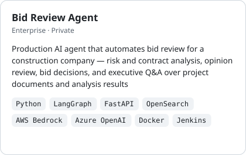
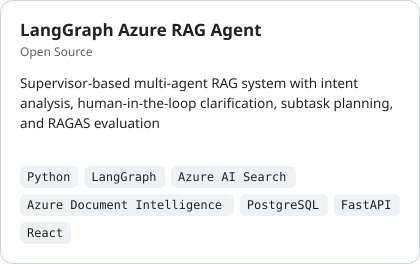

# Hello, I'm Seung Ju Baek

I'm an AI Engineer building AI products and agent systems for real-world services.

- **Focus:** Workflow Automation · Coding Agents · RAG · Evaluation · Infrastructure
- **Also:** LLM Post-training · Computer Vision

## Tech Stack

- **LLM & Agents:**    
- **RAG & Eval:**  
- **Model Training:**  
- **Backend & Infra:**     
- **Tools:**  

## Highlight Projects

  
  

## Contact

<a href="mailto:seungju41625886@gmail.com">seungju41625886@gmail.com</a>
